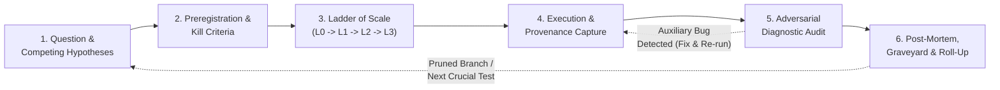

# `big-probs` Research Operating System & Empirical Procedure (`PROCEDURE.md`)

> **Purpose:** This document is the canonical Standard Operating Procedure (SOP) governing all empirical AI research, Pareto-frontier exploration, and cross-session continuity in `big-probs`. It is designed to operate symmetrically for **human researchers** and **autonomous AI agents** resuming from a **zero-context cold restart in under 2 minutes**.

---

## §1 First Principles of High-Leverage Research Procedure

Empirical machine learning research rarely stalls for lack of ideas or compute; it stalls because of **methodological entropy**. Across both human labs and autonomous research agents, five recurring pathologies destroy research velocity:

1. **Unstated or unfalsifiable hypotheses:** Running experiments to "see what happens" rather than to decisively eliminate competing explanations (Platt, 1964; Popper, 1959).
2. **Moving goalposts & degenerating patch chains:** Explaining away negative results with post-hoc excuses instead of distinguishing core-theory falsification from auxiliary engineering bugs (Lakatos, 1970).
3. **Unnormalized compute comparisons:** Claiming a "smaller" model beats a larger one while silently spending $3\times$ more inference FLOPs, $10\times$ more tuning budget, or hidden teacher distillation (Hoffmann et al., 2022; Snell et al., 2024; Lipton & Steinhardt, 2018).
4. **Institutional amnesia & survivorship bias:** Discarding failed runs, dead-end hyperparameters, and subtle bugs so future sessions—especially fresh AI agent contexts—repeatedly rediscover the same traps (Chen et al., 2025; Young, 2025).
5. **Scalar metric myopia:** Optimizing a single leaderboard number (e.g., in-distribution accuracy) while hiding regressions in inference cost, OOD generalization, causal faithfulness, or calibration under uncertainty (Dehghani et al., 2021; Gao et al., 2022).

### The Four Pillars Governing `big-probs`

| Pillar | Foundational Anchor | Operational Mandate in `big-probs` |
| :--- | :--- | :--- |
| **1. Strong Inference** | Platt (1964); Popper (1959) | Every experiment must sit on a **decision tree of competing hypotheses** (`H_A` vs. `H_B`), paired with a *crucial test* whose outcome prunes at least one branch. |
| **2. Progressive Research Programs** | Lakatos (1970); Hamming (1986) | Attack high-leverage foundational problems ("working with the door open"). Separate the **hard core** (`H1`, `H2`, `H3` in `00-unified-framework.md`) from the **auxiliary belt** (delimiters, batch sizes, optimizer schedules). A program is *progressive* only when new predictions yield verified novel gains, not just retroactive patches. |
| **3. Empirical ML Rigor** | Karpathy (2019); Lipton & Steinhardt (2018); Pineau et al. (2021); Bouthillier et al. (2021) | Climb a strict **Ladder of Scale** (unit invariants $\to$ single-batch overfit $\to$ CPU micro-pilot $\to$ GPU pilot $\to$ multi-seed scale). Isolate sources of gain, tune baselines symmetrically, and quantify multi-seed variance before declaring victory. |
| **4. Verifiable Agentic Integrity** | Lu et al. (2024); Chen et al. (2024); Starace et al. (2025); Chen et al. (2025); Young (2025) | Recent audits of autonomous research agents (*ScienceAgentBench*, *PaperBench*, *MLR-Bench*) expose a severe **execution gap**: fabricated or stale metrics, unexecuted code paths, and lenient self-evaluation. In `big-probs`, **no claim exists unless cryptographically or structurally bound to an immutable artifact** (Git SHA + metrics JSON + HF URI) and audited independently of its author. |

---

## §2 The 6-Stage Experiment Lifecycle

No non-trivial experiment (`EXP-xxx`) may skip stages or reorder them. Every transition requires a concrete, checkable artifact.



### Stage 1: Question & Competing Hypotheses
- **Anchor to the Registry:** Link the experiment explicitly to one or more Research Questions (`RQ-xxx`) or cross-track hypotheses (`H1`, `H2`, `H3`, `H1a–H1c`) in `research/QUESTIONS.md`.
- **Enumerate Competing Hypotheses:** State at least two mutually exclusive explanations before writing code (e.g., *H1a: Dense Brier reward `R3` eliminates GRPO $\sigma=0$ group-variance collapse relative to binary exact-match `R1`* vs. *Null: Small-model cold-start collapse is capacity-bound regardless of reward density*).
- **Check the Dead-Ends Graveyard:** Read `research/BACKLOG.md` before proposing a run. If a proposed mechanism previously failed, state *explicitly* what structural variable has changed to invalidate the prior disproof.

### Stage 2: Preregistration & Kill Criteria
Inspired by the NeurIPS Pre-registration Workshop (Bertinetto et al., 2021) and modern agentic locked-instruction protocols:
- **Commit Before Compute:** Instantiate `research/templates/EXP_PREREG.md` (or record the planned spec in `research/EXPERIMENTS.md` and `research/experiments.jsonl` with `"status": "planned"`) and commit it to Git **before** launching training.
- **Freeze Evaluation Axes:** Specify primary Pareto axes, iso-compute baselines (`B1`, `B2`, `B3`, `B4`, `B5` where applicable), sample sizes, seeds, and exact verdict logic.
- **Define Explicit Kill-Gates (Stop-Loss Rules):** Pre-specify abort conditions that terminate a doomed run early without guilt:
  - *Stability kill-gate:* NaN/Inf loss, gradient norm explosion, or policy entropy collapse below threshold for $>N$ consecutive steps.
  - *Signal kill-gate:* GRPO zero-variance fraction (`sigma=0`) $>0.90$ across an entire micro-window after warmup.
  - *Anti-sabotage kill-gate:* Frozen no-thought anchor NLL drift exceeding preregistered bound, or Regime 3 aleatoric ECE spiking $>0.15$.
  - *Dominance kill-gate:* At 25% of compute budget, candidate trails the iso-FLOPs baseline (`B2`) and pause control (`B3`) by $>2\sigma$ with flat slope.

### Stage 3: Minimum Viable Falsification (The Ladder of Scale)
Following Karpathy (2019), never spend high-tier GPU budgets to discover bugs detectable in seconds on CPU. Every new algorithm, reward, or architecture must pass lower rungs sequentially:

| Rung | Scale & Budget | Purpose | Mandatory Exit Gate |
| :--- | :--- | :--- | :--- |
| **L0 — Micro-Invariant** | `<10 sec` CPU (`pytest`) | Verify shapes, loss gradients, masking, reward bounds, train/eval log-prob parity (`<1e-4`), and single-batch overfit. | 100% unit tests pass; single batch drives loss $\to 0$ cleanly. |
| **L1 — CPU Micro-Pilot** | `1–5 min` CPU (e.g., `~1M–3M` params, `EXP-001`) | Validate end-to-end multi-arm pipeline, reward variance (`sigma=0` frac), calibration stability, and telemetry plumbing. | Zero NaNs; all diagnostic probes run; scope explicitly labeled *proof-of-life*, never extrapolated as large-scale proof. |
| **L2 — Single-Node GPU Pilot** | `10–50` H100 GPU-hrs (e.g., `160M/410M/1.0B`, `EXP-002`) | Primary hypothesis falsification at real representational capacity across Regimes 1–3 with isoFLOPs baselines. | Meets preregistered falsification criteria or cleanly prunes hypothesis. |
| **L3 — Multi-Seed & Matrix Scale** | `50–500` H100 GPU-hrs (e.g., `EXP-003..005`) | Statistical significance ($\ge 3$ seeds, bootstrap CIs per Bouthillier et al., 2021), cross-domain generalization, and Pareto curve fitting. | Reproducible dominance / hypervolume gain with confidence intervals. |

### Stage 4: Execution & Provenance Capture
Every completed run must emit a self-contained JSON metrics artifact (e.g., `phase1_pilot/results/micro_pilot_metrics.json`) capturing the **Minimum Provenance Graph**:
1. **Code identity:** exact `git_sha` (and dirty-tree check: *no official L2/L3 runs from uncommitted working trees*).
2. **Data identity:** dataset version/HF revision or deterministic generator config + SHA-256 hash of split manifests.
3. **Hyperparameter & seed identity:** complete serialized config + RNG seed(s) (`seed=42`, etc.).
4. **Compute & hardware identity:** exact GPU/CPU model, wall-clock seconds, estimated training FLOPs, and **exact inference FLOPs/token** for every arm.
5. **Artifact pointers:** local path + HuggingFace Hub URI (`queelius/big-probs-phase1-models` / `queelius/big-probs-phase1-data`) when checkpoints or datasets are published.

### Stage 5: Adversarial Diagnostic Audit
**Rule of Separation:** The person or agent who implemented a training or evaluation change must not be the sole verifier of headline claims. Before promoting results to `STATE.md` or publishing:
- **Interface Parity Audit:** Verify numerically (`max_abs_diff < 1e-4`) that the evaluation forward pass matches the training rollout interface (delimiters, latent steps, KV cache, dtype).
- **Causal Faithfulness Probes:** Never trust accuracy alone for latent reasoning. Check `ΔNLL_swap` (swapping thoughts across prompts) and `ΔNLL_trunc` (format-matched truncation/orthogonal perturbation), plus monotonic scaling with reasoning depth (`d in {2, 4, 6, 8}`).
- **Negative-Control & Goodhart Audit:** Check Regime 3 aleatoric calibration (`ECE`, `Brier`, overconfidence gap) and verify the policy did not sabotage its no-thought baseline or exploit a verifier shortcut (Manheim & Garrabrant, 2018; Gao et al., 2022).
- **Re-Execution Spot Check:** Confirm tests pass (`uv run pytest -v`) and reported tables match raw JSON numbers to the last reported decimal place (Pineau et al., 2021; Starace et al., 2025).

### Stage 6: Post-Mortem, Negative-Result Logging & State Roll-Up
An experiment is **not finished** when the training script exits—it is finished only when its knowledge is durable:
1. Ingest the raw metrics JSON into the append-only ledger via `phase1_pilot/scripts/log_experiment.py` $\to$ `research/experiments.jsonl`.
2. Write a concise post-mortem in `research/EXPERIMENTS.md` stating: verdict (`CONFIRMED` / `PARTIALLY-CONFIRMED` / `FALSIFIED` / `INCONCLUSIVE`), what broke, what surprised us, and the exact decision taken.
3. Update hypothesis statuses & gap analyses in `research/QUESTIONS.md`.
4. Log any falsified mechanisms, reward collapses, or engineering traps in the **Dead-Ends Graveyard** (`research/BACKLOG.md`).
5. Refresh `research/STATE.md` so the next cold-restarting human or agent sees the new ground truth immediately.

---

## §3 Pareto Frontier & New-Frontier Exploration Discipline

In `big-probs`, we are not chasing a single benchmark score—we are testing whether self-supervised RL and universal verification can **shift the compute-parameter-capability Pareto frontier** and **open new frontiers** where human-written verifiers do not exist.

### 3.1 Strict Compute Normalization Rules
Following Kaplan et al. (2020), Hoffmann et al. (2022, Chinchilla isoFLOPs), and Snell et al. (2024, iso-compute test-time scaling):

1. **Always Normalize Inference FLOPs (`FLOPs/tok`):** A small model (`B1`, $N_s$ parameters) generating $K$ latent or discrete thought steps per target token expends roughly $(1 + K)\times$ the forward-pass FLOPs of a single-pass model. Therefore:
   - Never report a latent-CoT arm against raw `B1` alone.
   - Always include an **iso-inference-FLOPs parameter-scaled baseline (`B2`)** whose single-pass cost matches the small model + thinking overhead, AND an **iso-FLOPs pause/dummy-compute control (`B3`)** to separate genuine algorithmic reasoning from extra transformer depth/compute.
2. **Track Both Training Compute and Inference Compute Separately:** Record total `compute_hours` (training GPU-hrs / training FLOPs) *and* `inference_flops_per_token` (as ratio vs. `B2`). A method that saves $2\times$ inference FLOPs at $10\times$ training cost sits on a different operational trade-off than one that wins at equal training FLOPs.
3. **Include Latency & Memory Footprint:** When comparing continuous latent steps (`B4`, `I2-Hybrid`) against discrete CoT (`RL-R1`, `RL-R3`) and larger dense models (`B2`), report both parameter count (VRAM footprint) and sequential decoding steps (`extra_steps_per_target`), since sequential steps bound wall-clock latency even when FLOPs match.

### 3.2 Multi-Objective Dominance & Hypervolume Tracking
Every `big-probs` arm is evaluated as a point in a **5-axis multi-objective space** (higher is better after sign normalization):

1. **Task Quality:** Exact Accuracy, Hard-BPB ($-\text{BPB}$), and OOD `pass@k` (`d={6,8}`).
2. **Compute Efficiency:** $-\text{Inference FLOPs/tok}$ (and $-\text{Training GPU-hrs}$).
3. **Model Compactness:** $-\text{Total Parameters}$ (enabling deployment on smaller hardware).
4. **Causal Faithfulness:** $\Delta\text{NLL}_{\text{swap}}$ and $\Delta\text{NLL}_{\text{trunc}}$ (proving the latent trace actually carries causal computation, not decorative tokens).
5. **Calibration & Anti-Goodhart Robustness:** $-\text{Regime 3 ECE}$ and cross-verifier / stealth-Goodhart gap.

**Dominance Rule:** Arm $A$ **Pareto-dominates** Arm $B$ ($A \succ B$) iff $A$ is at least as good as $B$ on all tracked primary axes and strictly better on at least one. Across an experimental phase, measure frontier progress via the **Hypervolume Indicator ($HV$)** (Zitzler & Thiele, 1998)—the dominated volume between the non-dominated front and a fixed pessimistic reference point $r_{\text{ref}}$—so improvements along *any* axis (e.g., matching `B2` Hard-BPB at half the parameters and equal FLOPs) are captured rigorously without arbitrary scalar weighting.

### 3.3 Three Regimes of Progress (Never Confuse Them)

| Regime | Geometric Meaning | Example in `big-probs` | Required Proof Standard |
| :--- | :--- | :--- | :--- |
| **A. Moving Along a Known Curve** | Trading one axis for another on an existing frontier (e.g., more FLOPs $\to$ lower BPB). | Increasing `B1` parameters to `B2`, or spending $2.51\times$ `B2` FLOPs in `I2-Hybrid` to approach `B2` Hard-BPB. | Useful for calibration and scaling-law fits; **not** a breakthrough claim. |
| **B. Shifting an Existing Frontier** | Strictly dominating prior non-dominated points ($\Delta HV > 0$ at matched or lower compute/params). | A teacher-free `160M` latent-CoT RL arm matching/beating `410M`/`1.0B` `B2` at $\le 1.0\times$ inference FLOPs *and* beating pause control `B3` by $\ge 3\text{pp}$ with causal $\Delta\text{NLL}_{\text{swap}} > 0.15$. | Requires isoFLOPs parity, causal faithfulness, multi-seed CIs, and adversarial audit. |
| **C. Opening a New Capability Frontier** | Creating a non-zero capability on an axis where existing supervised/RLVR methods have zero signal or fail catastrophically. | Cross-domain Tier 0B–2 automatic verification resisting correlated-prior stealth Goodharting (`H2`), or causal interventional replay lowering the slow-verification latency floor (`H3`). | Requires explicit negative controls, synthetic ground-truth oracle stress tests, and zero-leakage validation. |

### 3.4 Portfolio Allocation via Value of Information per GPU-Hour
With finite compute and engineering time, rank every queued item in `research/BACKLOG.md` by **Value of Information per Unit Cost**:

$$\text{Priority Score} = \frac{P(\text{falsifies a core hypothesis or shifts frontier}) \times \text{Downstream Decision Value}}{\text{Compute Cost (GPU-hr)} + \alpha \cdot \text{Engineering Effort (days)}}$$

Apply a disciplined **50 / 30 / 20 Research Portfolio Split**:
- **50% Core Frontier Falsification (Exploitation of Highest-Leverage Tests):** Crucial Platt tests of `H1`, `H2`, `H3` (e.g., `EXP-002` H100 Stage 1 Core Pilot, `EXP-003` Factorized Transfer Audit).
- **30% Cheap High-VoI Diagnostics & Synthetic Testbeds:** CPU-runnable ablations (`<10 min`), reward-shaping comparisons, synthetic `H2` correlated-prior Goodhart testbeds, and synthetic `H3` causal ordering-leakage probes that de-risk expensive GPU runs before launch.
- **20% Wildcat New-Frontier Exploration:** High-variance bets (novel verification symmetries, hybrid continuous/discrete credit assignment, teacher-free curriculum discovery) strictly governed by L0/L1 kill-gates so failures cost minutes rather than weeks.

---

## §4 Cold-Restart Protocol (<2-Minute Resume Standard)

Multi-month research programs—especially those combining human researchers and stateless AI agent sessions—collapse when critical context lives only in chat logs, terminal scrollback, or human memory. Inspired by Anthropic's engineering findings on long-running agent harnesses (Young, 2025) and failure-aware "negative knowledge" lab notebooks (Chen et al., 2025), `big-probs` enforces a **repo-native external memory architecture** engineered for a **<2-minute zero-context cold restart**.

### 4.1 Canonical `research/` File Architecture

| File | Role & Owner Discipline | Update Cadence |
| :--- | :--- | :--- |
| `research/STATE.md` | **30-Second Executive Briefing:** Current Pareto frontier snapshot, active hypothesis verdicts, open blockers, hardware status, and top-3 highest-VoI next actions. Keep concise (`<150` lines). | End of every session that changes empirical state. |
| `research/PROCEDURE.md` | **This SOP:** Invariant methodology, lifecycle gates, Pareto rules, and anti-patterns. | Rarely (only when process itself evolves). |
| `research/QUESTIONS.md` | **Living Hypothesis & RQ Registry:** Tracks `RQ-xxx` and `H1–H3` / `H1a–H1c` with status (`open`, `micro-validated`, `partially-confirmed`, `confirmed`, `falsified`), falsification criteria, linked evidence (`EXP-xxx`), and explicit *"What We're Missing"* gaps. | After every completed `EXP-xxx` post-mortem. |
| `research/EXPERIMENTS.md` | **Human-Readable Experiment Ledger:** Pareto frontier summary table, full post-mortems of completed runs (`EXP-001`, ...), and specs for planned runs (`EXP-002..005`). | After preregistration and post-mortem. |
| `research/experiments.jsonl` | **Canonical Machine-Readable Ledger:** Append-only NDJSON record of every experiment (metadata, provenance, per-arm Pareto metrics, bugs caught, artifact URIs). **Never rewrite history.** | Appended via `scripts/log_experiment.py`. |
| `research/BACKLOG.md` | **Frontier Queue, Missing Pieces & Dead-Ends Graveyard:** VoI/compute-ranked task queue, explicit gap audit, and permanent negative-result graveyard preventing repeat failures. | Whenever a new idea arises or a dead end is confirmed. |
| `research/templates/EXP_PREREG.md` | **Preregistration & Post-Mortem Template:** Copy-pasteable checklist enforcing Platt's strong inference, isoFLOPs parity, kill criteria, and provenance fields. | Template (cloned per major experiment). |
| `phase1_pilot/scripts/log_experiment.py` | **Ledger Automation Tool:** Ingests `*_metrics.json`, validates schema, appends to `research/experiments.jsonl`, and prints/updates the Markdown Pareto table. | Invoked at Stage 6 of every run. |

### 4.2 The <2-Minute Cold-Restart Sequence
Any new human or AI agent entering the repository with zero prior context executes this exact 4-step boot sequence before writing a single line of code or launching a run:

1. **`0:00 – 0:30` Orient on Ground Truth:** Read `research/STATE.md` top-to-bottom to absorb the current frontier, active phase, and top-3 priorities.
2. **`0:30 – 1:00` Check Hypotheses & Graveyard:** Scan the relevant `RQ`/`H` entries in `research/QUESTIONS.md` and the **Dead-Ends Graveyard** in `research/BACKLOG.md` so you do not re-run an already-falsified idea or hit a known trap.
3. **`1:00 – 1:30` Verify Recent Provenance:** Inspect the latest entry in `research/experiments.jsonl` (or `research/EXPERIMENTS.md`) and run `git log -n 5 --oneline && git status` to confirm exact code state.
4. **`1:30 – 2:00` Confirm Working Environment:** Run a quick sanity check (`cd phase1_pilot && uv run pytest -q`) if modifying code, then execute the preregistered next step.

### 4.3 Mandatory End-of-Session Handoff Checklist
Neither a human researcher nor an AI agent may terminate a working session with undocumented state. Before concluding, verify every box:

- [ ] **Code & Tests Clean:** All edits are committed (or cleanly isolated on a named branch) and unit tests pass (`uv run pytest -v`).
- [ ] **No Orphaned Runs:** Every executed experiment—including **failed, killed, or null runs**—has its metrics JSON saved and a record appended to `research/experiments.jsonl`.
- [ ] **Graveyard Updated:** Any discovered bug, collapsed reward, or falsified design choice is logged in `research/BACKLOG.md` (Dead-Ends Graveyard) with root cause and fix/avoidance rule.
- [ ] **Registry & State Refreshed:** `research/QUESTIONS.md`, `research/EXPERIMENTS.md`, and `research/STATE.md` reflect the latest empirical truth, with the single highest-VoI next command or action stated explicitly at the top of `STATE.md`.
- [ ] **Large Artifacts Offloaded:** Checkpoints (`.pt`) and datasets (`.parquet`) are excluded from Git (`.gitignore`) and uploaded to HuggingFace Hub when promoted beyond local scratch.

### 4.4 Anti-Drift & Epistemic Provenance Rules
To prevent narrative drift and agent hallucination across dozens of sessions:
1. **Every Claim Requires a Citation Tuple:** Any metric or empirical conclusion written in `STATE.md`, `QUESTIONS.md`, `EXPERIMENTS.md`, or `README.md` must link to `[EXP-xxx | git_sha or file path | raw JSON key | HF URI if applicable]`. Unlinked numbers are treated as unverified speculation.
2. **Append-Only History:** Never silently overwrite a historical JSONL row in `research/experiments.jsonl`. If an evaluation bug invalidates an earlier run (e.g., an interface mismatch), append a new record referencing `"supersedes": "EXP-xxx"` and note the root cause in `"bugs_caught"`.
3. **Explicit Epistemic Tagging:** Always separate **Verified Empirical Facts** (with exact scope, e.g., *CPU micro-scale 0.98M params, seed 42*) from **Scale Extrapolations** and **Open Hypotheses**. Never present L1 proof-of-life numbers as L2/L3 capability proofs.

---

## §5 Failure Modes & Anti-Patterns Checklist

Use this diagnostic checklist during Stage 2 (Design) and Stage 5 (Adversarial Audit). Every item represents a documented failure mode in the empirical ML literature—and several have already been observed firsthand in `big-probs`.

### 1. Train/Eval Interface Skew *(Real `big-probs` Case Study!)*
- **The Trap:** Training rollouts and evaluation forward passes silently diverge in tokenization, special delimiters, latent-step count, KV-cache handling, or dtype. Because the model still outputs valid probabilities, the bug masquerades as a "model failure" (high loss, catastrophic calibration collapse) rather than crashing.
- **Forensic Example (`EXP-001` `I2-Hybrid` in `phase1_pilot`):** During `EXP-001` CPU micro-pilot verification, `I2-Hybrid` (`hybrid_latent`) initially appeared to suffer catastrophic overconfidence collapse (`Exact Acc = 0.0%`, `Hard-BPB = 5.030`, `Reg3 ECE = 0.844`, `4.71× B2 FLOPs`). An independent adversarial audit of the saved checkpoint (`i2_hybrid/checkpoint.pt`) caught the root cause: training (`ContinuousLatentWrapper.rollout_hybrid` & `recompute_hybrid_logprobs_and_continuation`) ran `thought_len=6` HRPO-blended steps directly after `prefix_ids` with *no* prepended pure continuous latents and *no* `<think>`/`</think>` delimiters, whereas `phase1_pilot/eval/diagnostics.py` had prepended 4 extra continuous latents AND wrapped the 6 blended steps in `<think>`/`</think>` (12 extra steps total). Once evaluation was aligned to the native trained interface and locked with a `< 1e-4` log-prob parity unit test in `tests/test_eval.py`, `I2-Hybrid` jumped from apparent collapse to the **strongest candidate arm in `EXP-001`**: `Exact Acc = 3.1%`, `Hard-BPB = 2.271` (nearly matching `2.9×`-larger `B2`'s `2.266`), `OOD pass@16 = 37.5%` (beating `B1`/`B2`'s `31.2%`), well-calibrated `Reg3 ECE = 0.032`, at `2.51× B2 FLOPs`.
- **Mandatory Prevention:** Every new model variant must include an automated L0 unit test asserting `max(|eval_logprobs - train_recompute_logprobs|) < 1e-4` on identical inputs.

### 2. Sparse Reward Starvation & Group-Variance Collapse ($\sigma = 0$ Trap)
- **The Trap:** Under group-relative RL (GRPO / RLOO), when a small base model has near-zero initial probability of hitting a binary exact-match reward (`R1`), all $G$ rollouts in a group receive identical reward (`0` or `1`), yielding group standard deviation $\sigma = 0$ and identically zero policy gradient.
- **Observed Evidence (`EXP-001`):** `RL-R1` (binary exact-match) hit `sigma=0 frac = 1.00` across RL steps (complete gradient starvation), whereas dense proper-scoring Brier reward (`RL-R3`) and `I2-Hybrid` maintained `sigma=0 frac = 0.00` throughout training.
- **Mandatory Prevention:** Always log `sigma=0 frac` and policy entropy per step; require dense, strictly proper scoring rewards (`R3` Brier / log-prob gain) or hybrid support-expansion mechanisms when cold-starting small models.

### 3. P-Hacking, Seed-Shopping & Unreported Variance
- **The Trap:** Running 5 seeds or 20 hyperparameter sweeps and reporting only the best run—or comparing single-seed point estimates whose gap is smaller than run-to-run variance (Bouthillier et al., 2021).
- **Mandatory Prevention:** Single-seed runs are permitted **only** at L1 (micro proof-of-life) and L2 (initial falsification screening). Any headline claim of frontier shifting (L3) requires $\ge 3$ preregistered seeds, reporting mean $\pm$ 95% bootstrap CI and disclosing *all* crashed or discarded seeds.

### 4. Baseline Neglect & Asymmetric Tuning
- **The Trap:** Spending weeks tuning the proposed method (`I2-Hybrid`, `RL-R3`) while leaving `B1`/`B2`/`B3` at untuned defaults—attributing hyperparameter effort to architectural novelty (Lipton & Steinhardt, 2018; Dehghani et al., 2021).
- **Mandatory Prevention:** Allocate equal tuning budget and identical optimizer/data pipelines across all arms; verify that `B2` and `B3` are strong, clean baselines before interpreting lift.

### 5. Silent Verifier Drift & Reward Overoptimization (Goodharting)
- **The Trap:** Optimizing aggressively against a learned or live proxy verifier causes true capability to peak and then collapse (Regressional / Extremal / Causal / Adversarial Goodhart; Manheim & Garrabrant, 2018; Gao et al., 2022). In self-supervised RL, a live policy computing its own no-thought baseline can trivially maximize `log P(y|z,x) - log P(y|x)` by **sabotaging** its no-thought predictions!
- **Mandatory Prevention:** Lock the reference no-thought baseline to a **frozen anchor checkpoint**, log `No-Thought NLL Drift` every step, include Regime 3 aleatoric negative controls (where thinking cannot help and overconfidence signals reward hacking), and run cross-modal / independent verifier audits (`H2`).

### 6. Premature Scaling Before Micro-Falsification
- **The Trap:** Launching a 40-hour H100 run before verifying L0 parity tests, L1 CPU micro-pilot convergence, multi-GPU `torchrun` synchronization, and checkpoint resume logic (Karpathy, 2019).
- **Mandatory Prevention:** Enforce the L0 $\to$ L1 $\to$ L2 $\to$ L3 gate strictly. A launcher script (`launch_h100_stage1.sh`) must pass `bash -n`, CLI flag parity against `train.py --help`, and a distributed/single-step smoke check before GPU allocation.

### 7. Benchmark Contamination & Split Leakage
- **The Trap:** Evaluating OOD generalization on distributions that overlap training templates, or evaluating pretrained models on web benchmarks memorized during pretraining (Oren et al., 2024).
- **Mandatory Prevention:** Enforce strict programmatic separation of ID (`d={2,4}`) vs. OOD (`d={6,8}`) problem generators with disjoint RNG streams/hashes; for Regime 2 web-text evaluations, document corpus provenance and run n-gram / perplexity contamination checks.

### 8. Agentic Execution-Gap Hallucination
- **The Trap:** Autonomous agents summarizing expected results instead of actually executed outputs, omitting failed assertions, or editing prose reports without re-running metrics pipelines (Chen et al., 2024; Starace et al., 2025; Chen et al., 2025).
- **Mandatory Prevention:** Generate Markdown result tables programmatically from raw JSON (`micro_pilot_metrics.json` via `log_experiment.py`), require independent verifier review before marking releases `[done]`, and forbid manual transcription of metrics without automated cross-checks.

### 9. Negative-Result Suppression (Amnesia Bias)
- **The Trap:** Treating `FALSIFIED` runs (like `EXP-001`'s honest CPU micro-scale `FALSIFIED` verdict) as embarrassments to hide rather than valuable scientific signal.
- **Mandatory Prevention:** Celebrate clean falsifications! Every falsified run prunes Platt's hypothesis tree and belongs permanently in `EXPERIMENTS.md`, `experiments.jsonl`, and `BACKLOG.md`'s Dead-Ends Graveyard.

---

## §6 Lightweight Tooling & Git+HF Artifact Discipline

High-velocity research requires zero-friction tooling that cleanly separates **code & structured knowledge** from **heavy binary artifacts**.

### 6.1 Storage Boundary: GitHub vs. HuggingFace Hub vs. Local Scratch

| Artifact Class | Canonical Home | Examples | Rules |
| :--- | :--- | :--- | :--- |
| **Code, Configs, Docs, Research Memory & Small Metrics JSONs** | **GitHub** (`queelius/big-probs`) | `00..03-*.md`, `research/{STATE,PROCEDURE,QUESTIONS,EXPERIMENTS,BACKLOG}.md`, `research/experiments.jsonl`, `phase1_pilot/{phase1_pilot,scripts,tests}/`, `results/micro_pilot_{report.md,metrics.json}` | Tracked in Git; clean diffs; `<1 MB` per file; zero secrets, zero `.venv/`, zero `.pt`/`.parquet`. |
| **Model Checkpoints & Large Datasets** | **HuggingFace Hub** (`queelius/big-probs-phase1-models`, `queelius/big-probs-phase1-data`) | `*.pt` / `*.safetensors` arm checkpoints, Parquet train/eval splits, Model Cards & Dataset Cards | Published via `phase1_pilot/scripts/publish_hf.py`; pinned by repo URI + revision SHA inside `experiments.jsonl`. |
| **Ephemeral Scratch & Intermediate Logs** | **Local disk (`.gitignore`d)** | `.venv/`, `.pytest_cache/`, intermediate optimizer states, unverified debug runs (`results/micro_runs/*.pt`) | Never committed to Git; safe to purge once promoted artifacts are uploaded to HF Hub and metrics are logged. |

### 6.2 Dual-Layer Ledger: Append-Only JSONL + Human Markdown Synthesis
`big-probs` avoids heavyweight database infrastructure in favor of two complementary, Git-friendly layers:

1. **Machine-Canonical Layer (`research/experiments.jsonl`):** One self-contained JSON object per line, appended via `phase1_pilot/scripts/log_experiment.py`. Enables instant Pandas/Python Pareto plotting, hypervolume computation, regression checks, and exact parsing by AI agents.
   - *Core schema fields:* `exp_id`, `date`, `title`, `rq_ids`, `scale`, `hardware`, `compute_hours`, `status`, `verdict`, `pareto_axes`, `arms` (params, `flops_ratio`, `exact_acc`, `hard_bpb`, `ood_pass_at_k`, `delta_nll_swap`, `delta_nll_trunc`, `reg3_ece`, `sigma_zero_frac`), `artifacts` (local paths, `git_sha`, HF URLs), `bugs_caught`, `lessons` (plus optional `supersedes`).
2. **Human-Readable Synthesis Layer (`research/EXPERIMENTS.md`, `STATE.md`, `QUESTIONS.md`, `BACKLOG.md`):** Curated tables, Platt decision trees, forensic post-mortems, and next-action briefings derived directly from the JSONL ledger and raw metrics JSONs.

### 6.3 Naming & Versioning Conventions
- **Experiment IDs:** Monotonic zero-padded `EXP-001`, `EXP-002`, ... (never reused; superseded runs receive a new ID with `"supersedes"`).
- **Research Questions & Hypotheses:** `RQ-01`..`RQ-0N` and `H1`, `H1a`, `H2`, `H3` matching `00-unified-framework.md` and `research/QUESTIONS.md`.
- **Standard Ingestion & Publishing Commands (Stage 6):**
  ```bash
  cd phase1_pilot
  # Inspect schema/flags and validate a new metrics JSON before appending to ../research/experiments.jsonl
  uv run python scripts/log_experiment.py --help
  uv run python scripts/log_experiment.py --dry-run ...

  # Publish promoted checkpoints & Parquet splits to HuggingFace Hub
  uv run --with huggingface_hub python scripts/publish_hf.py --tag <run-tag> --run-dir <run-dir>
  ```

---

## §7 Verified References

### Classical Scientific Method & Research Strategy
- **Hamming, R. W. (1986).** *You and Your Research.* Bell Communications Research (Bellcore) Colloquia Series, Morris Research and Engineering Center, Morristown, NJ, March 7, 1986.
- **Lakatos, I. (1970).** Falsification and the methodology of scientific research programmes. In I. Lakatos & A. Musgrave (Eds.), *Criticism and the Growth of Knowledge* (pp. 91–195). Cambridge University Press. DOI: `10.1017/CBO9781139171434.009`.
- **Platt, J. R. (1964).** Strong Inference: Certain systematic methods of scientific thinking may produce much more rapid progress than others. *Science*, 146(3642), 347–353. DOI: `10.1126/science.146.3642.347`.
- **Popper, K. R. (1959).** *The Logic of Scientific Discovery.* London: Hutchinson / Routledge.

### Empirical ML Rigor, Reproducibility, Scaling Laws & Pareto Analysis
- **Bertinetto, L., Henriques, J. F., Albanie, S., Paganini, M., & Varol, G. (Eds.). (2021).** *NeurIPS 2020 Workshop on Pre-registration in Machine Learning.* Proceedings of Machine Learning Research (PMLR), Vol. 148 (`https://proceedings.mlr.press/v148/`).
- **Bouthillier, X., Delaunay, P., Varoquaux, G., Vincent, P., et al. (2021).** Accounting for Variance in Machine Learning Benchmarks. *Proceedings of Machine Learning and Systems (MLSys 2021)*.
- **Dehghani, M., Tay, Y., Gritsenko, A. A., Zhao, Z., Houlsby, N., Diaz, F., Metzler, D., & Vinyals, O. (2021).** The Benchmark Lottery. *arXiv preprint arXiv:2107.07002*.
- **Gao, L., Schulman, J., & Hilton, J. (2022).** Scaling Laws for Reward Model Overoptimization. *Proceedings of the 40th International Conference on Machine Learning (ICML)* / *arXiv:2210.10760*.
- **Hoffmann, J., Borgeaud, S., Mensch, A., et al. (2022).** Training Compute-Optimal Large Language Models. *arXiv preprint arXiv:2203.15556*.
- **Kaplan, J., McCandlish, S., Henighan, T., et al. (2020).** Scaling Laws for Neural Language Models. *arXiv preprint arXiv:2001.08361*.
- **Karpathy, A. (2019, April 25).** *A Recipe for Training Neural Networks.* (`https://karpathy.github.io/2019/04/25/recipe/`).
- **Lipton, Z. C., & Steinhardt, J. (2018).** Troubling Trends in Machine Learning Scholarship.
- **Manheim, D., & Garrabrant, S. (2018).** Categorizing Variants of Goodhart's Law. *arXiv preprint arXiv:1803.04585*.
- **Oren, Y., Meister, N., Chatterji, N. S., Ladhak, F., & Hashimoto, T. (2024).** Proving Test Set Contamination in Black-Box Language Models. *Proceedings of the International Conference on Learning Representations (ICLR 2024)* / *arXiv:2310.17623*.
- **Pineau, J., Vincent-Lamarre, P., Sinha, K., Larivière, V., Beygelzimer, A., d'Alché-Buc, F., Fox, E., & Larochelle, H. (2021).** Improving Reproducibility in Machine Learning Research (A Report from the NeurIPS 2019 Reproducibility Program). *Journal of Machine Learning Research (JMLR)*.
- **Snell, C., Lee, J., Xu, K., & Kumar, A. (2024).** Scaling LLM Test-Time Compute Optimally can be More Effective than Scaling Model Parameters. *ICLR* / *arXiv:2408.03314*.
- **Zitzler, E., & Thiele, L. (1998).** Multiobjective Optimization Using Evolutionary Algorithms—A Comparative Case Study. In *Parallel Problem Solving from Nature (PPSN V)* (pp. 292–304). Springer.

### Frontier Autonomous Research Ops & Cold-Restart Agent Memory (2024–2026)
- **Chen, H., Xiong, M., Lu, Y., Han, W., Deng, A., He, Y., Wu, J., Li, Y., Liu, Y., & Hooi, B. (2025).** MLR-Bench: Evaluating AI Agents on Open-Ended Machine Learning Research. *NeurIPS 2025 (Datasets and Benchmarks Track)* / *arXiv:2505.19955*.
- **Chen, Z., Chen, S., Ning, Y., et al. (2024).** ScienceAgentBench: Toward Rigorous Assessment of Language Agents for Data-Driven Scientific Discovery. *ICLR 2025* / *arXiv:2410.05080*.
- **Lu, C., Lu, C., Lange, R. T., Foerster, J., & Clune, J. (2024).** The AI Scientist: Towards Fully Automated Open-Ended Scientific Discovery. *arXiv preprint arXiv:2408.06292*.
- **Starace, G., Jaffe, O., Sherburn, D., et al. (2025).** PaperBench: Evaluating AI's Ability to Replicate AI Research. *arXiv preprint arXiv:2504.01848*.
- **Young, J. (Anthropic Engineering). (2025, November 26).** *Effective Harnesses for Long-Running Agents.* (`https://www.anthropic.com/research/effective-harnesses-for-long-running-agents`).
